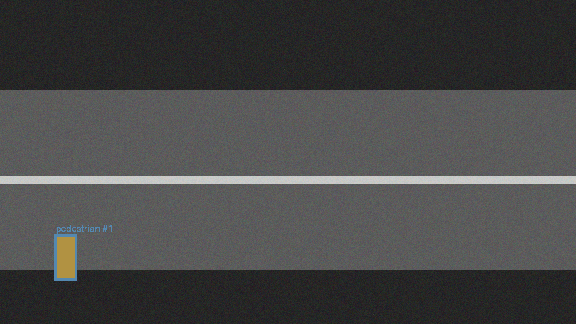
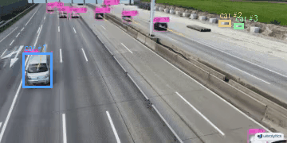

# Detection + Tracking Pipeline

A Python perception pipeline that watches a sequence of camera frames, detects road users, gives each object a persistent tracking ID, and exports an annotated demo, a per-frame tracking CSV, and a plain-language summary.

This project explores one of the core building blocks of robotics and autonomous-vehicle perception: turning individual image detections into stable object tracks that planning and control systems can use over time.

## Demo

### Synthetic test sequence



The generated test scene contains a car, a truck, and a pedestrian moving at different speeds. A pole deliberately hides the car during frames 30-36 so the project can test whether the tracker preserves the car's identity through a short occlusion.

### Real traffic frames



The real-data demo uses the included YOLO11n ONNX model on a 31-frame traffic clip. It demonstrates the detector and tracking pipeline on real images, but it is not a scored benchmark because that clip has no ground-truth labels.

## What the project does

For every frame, the pipeline:

1. Loads an image from a directory of PNG frames.
2. Runs a selected detector to find objects and produce bounding boxes, class labels, and confidence scores.
3. Matches new detections to objects already being tracked.
4. Reuses the existing track ID when a match is found, or creates a new track for a newly observed object.
5. Draws labeled boxes on the frame.
6. Exports the results as an animated GIF, a CSV of tracked boxes, and a summary.

The important distinction is that detection answers **"What is visible in this one image?"** while tracking answers **"Which object is this, and is it the same one I saw in the previous frames?"**

## Why it matters

A robot or vehicle cannot make reliable decisions from disconnected, frame-by-frame detections. Downstream systems need continuity: they need to know that the pedestrian in this frame is the same pedestrian from a moment ago, estimate how that object is moving, and avoid treating temporary occlusion as disappearance followed by a brand-new object.

This project demonstrates that perception layer in a small, inspectable codebase:

- Detector/tracker separation
- A shared detection format across multiple detector backends
- Bounding-box association with Intersection over Union (IoU)
- Persistent object IDs
- Short-term track coasting through missed detections and occlusion
- Kalman-filter motion prediction
- Tracking evaluation concepts, including ID switches and fragmentations
- Honest separation between verified results, unscored demos, and work still pending

## How it works

```text
PNG frames
    |
    v
Detector backend
    |
    |  Standard detection format:
    |  { bounding box [x1, y1, x2, y2], label, confidence }
    v
Multi-object tracker
    |
    +--> matched detection  -> keep existing ID
    +--> new detection      -> create a new ID
    +--> missing detection  -> coast briefly before retiring the track
    |
    v
Annotated GIF + tracks.csv + summary.txt
```

### Detector backends

All detectors return the same format, so changing the detector does not require changing the tracker interface.

| Backend | Command value | Purpose |
|---|---|---|
| Color segmentation | `color` | A small offline detector designed specifically for the generated synthetic scene. It finds the known object colors and produces boxes without requiring a dataset or model download. |
| YOLO11n ONNX | `yolo_onnx` | The verified real-image path. It runs the included `yolo11n.onnx` model through ONNX Runtime, avoiding a PyTorch/Ultralytics installation. |
| YOLO11n Ultralytics | `yolo` | A convenience path that uses the Ultralytics package and downloads its model weights on first use. |

The YOLO paths keep the vehicle and road-user classes relevant to this project: pedestrian/person, bicycle, car, motorcycle, bus, and truck. The ONNX implementation performs letterboxing to 640 x 640, filters by confidence, applies class-specific non-maximum suppression, and converts the resulting boxes back into the original frame coordinates.

The color detector is intentionally narrow: it is a controlled-scene test detector, not a general-purpose replacement for a learned object detector.

### IoU tracker

`src/tracker.py` contains a SORT-style tracker written from scratch. It:

- Compares every current track with every new detection of the same label.
- Calculates IoU for each pair.
- Greedily accepts the highest-scoring matches first.
- Uses an IoU threshold of `0.3` in the command-line pipeline.
- Creates a new track for each unmatched detection.
- Lets an unmatched track survive for up to `max_age=10` frames.
- Does not draw or export a coasting track on frames where it has no detection.

That short survival window is what allows the synthetic car to keep its ID through the scripted pole occlusion instead of immediately being deleted and later recreated as a supposedly new car.

### Kalman tracker

`src/tracker_kalman.py` contains a second tracker with the same `update(detections)` interface. Each track has a constant-velocity Kalman filter over:

```text
[center x, center y, width, height, velocity x, velocity y, width velocity, height velocity]
```

Before association, every track is predicted one frame forward and detections are matched against the predicted boxes rather than only the last observed boxes. Matched detections then correct the filter.

The Kalman tracker also includes a ByteTrack-inspired second association pass. Leftover tracks and detections can be matched when their centers are close enough to the prediction, even if their boxes do not overlap. This handles the cold-start case in which a newly created track has zero estimated velocity and then moves by more than one box width on the next frame.

The command-line runner currently instantiates the IoU tracker. The Kalman tracker is included as a drop-in alternative module and is the basis for the motion-model comparison below.

## Quick start: run the verified demo

### Requirements

- Python 3
- NumPy and Pillow for the offline demo

Install the base requirements:

```bash
pip install -r requirements.txt
```

Generate the 60-frame synthetic sequence and its ground-truth CSV:

```bash
python src/make_synthetic_sequence.py data/synthetic
```

Run the complete pipeline:

```bash
python src/run_pipeline.py data/synthetic out
```

This creates:

```text
out/
├── annotated.gif
├── summary.txt
└── tracks.csv
```

### Verified synthetic result

The included checked-in output reports:

```text
frames processed: 60
detector: color
car: 1 unique track ID(s) -> [2]
pedestrian: 1 unique track ID(s) -> [1]
truck: 1 unique track ID(s) -> [3]
occlusion check (frames 30-36, car behind pole): PASS - car kept a single ID through the occlusion
```

In other words, each of the three objects held one identity for the full sequence, including the car during its seven-frame occlusion.

## Run it on real frames

### Option A: YOLO11n with ONNX Runtime

Install the additional runtime:

```bash
pip install onnxruntime
```

Place PNG frames in a directory and run:

```bash
python src/run_pipeline.py path/to/frames out_real --detector yolo_onnx
```

The included model is `yolo11n.onnx` in the repository root. A different model path can be supplied through the `YOLO_ONNX_PATH` environment variable.

The checked-in real-frame run is in `out_yolo/`:

- 31 frames processed
- YOLO ONNX detector used
- 177 tracked-box rows written to `tracks.csv`
- Annotated result saved as `out_yolo/annotated.gif`

This run proves the pipeline operates on real images. Because the clip is unlabeled, it should not be quoted as an accuracy, ID-switch, or tracking benchmark.

### Option B: YOLO through Ultralytics

Install Ultralytics and run:

```bash
pip install ultralytics
python src/run_pipeline.py path/to/frames out_real --detector yolo
```

Ultralytics may download the YOLO11n weights the first time this backend is used.

## Understanding the outputs

### `annotated.gif`

An animation of the input frames with a colored bounding box and label such as `car #2` drawn around each visible tracked object.

### `tracks.csv`

One row for each visible tracked box in each frame:

```text
frame,track_id,label,x1,y1,x2,y2
```

The coordinates describe the left, top, right, and bottom edges of the bounding box in pixels.

### `summary.txt`

A short report containing:

- Number of frames processed
- Detector used
- Unique track IDs observed for each label
- The result of the synthetic occlusion check

The occlusion line is designed for the generated demo, where the expected occlusion is known in advance. It is not intended as a general-purpose metric for arbitrary real-world clips.

## Evaluation tools

### Synthetic-scene test

The generated scene provides a controlled test with known objects and a known occlusion period. It verifies the basic behavior that matters for this project:

- Objects are detected in every relevant frame.
- IDs remain stable while objects move.
- The car's identity survives temporary occlusion.
- The pipeline produces complete, inspectable outputs.

### Fast-object stress comparison

A simple IoU tracker has a known weakness: if an object moves farther than its own width between frames, its old and new boxes have zero overlap and association fails.

In the recorded development stress test—a 50-pixel box moving 90 pixels per frame for 12 frames:

- IoU tracker: **12 unique IDs in 12 frames**
- Kalman tracker: **1 unique ID in 12 frames**

The difference demonstrates why a motion model matters. The IoU tracker can only ask whether the new detection overlaps the last box; the Kalman tracker first predicts where the object should be.

### KITTI scorer

`src/score_kitti.py` compares tracker output with KITTI tracking ground truth. It performs greedy, highest-IoU matching per frame and reports:

- Total ID switches
- ID switches on consecutive frames
- ID switches after a gap
- Fragmentations
- Matched ground-truth boxes by class
- Coverage for each ground-truth track

Example, after producing a KITTI tracking CSV:

```bash
python src/score_kitti.py data/kitti_sample/label_02/0000.txt out_kitti/tracks.csv --iou 0.5 --out metrics.txt
```

KITTI scoring is wired, but a KITTI result is **not claimed here**. The KITTI tracking sample still has to be downloaded separately and placed in `data/kitti_sample` before an official scored run can be reported.

## Repository structure

```text
.
├── README.md
├── requirements.txt
├── yolo11n.onnx                 # YOLO11n model used by the ONNX backend
├── data/
│   └── vehicle.mp4              # Short source clip used for the real-frame demo
├── out/                         # Checked-in synthetic demo outputs
│   ├── annotated.gif
│   ├── summary.txt
│   └── tracks.csv
├── out_yolo/                    # Checked-in real-frame demo outputs
│   ├── annotated.gif
│   ├── summary.txt
│   └── tracks.csv
└── src/
    ├── detect.py                # Color, YOLO ONNX, and Ultralytics detectors
    ├── make_synthetic_sequence.py
    ├── run_pipeline.py          # End-to-end command-line pipeline
    ├── score_kitti.py           # ID-switch and fragmentation scorer
    ├── tracker.py               # SORT-style IoU tracker
    └── tracker_kalman.py        # Constant-velocity Kalman tracker
```

## Design choices

### Why camera frames?

Camera data is inexpensive and information-rich, and public driving datasets provide labeled sequences with ground truth. Starting with images keeps the project focused on detection, association, identity persistence, and evaluation before adding the cost and complexity of physical sensors or a robot.

### Why build a simple tracker from scratch?

Using an existing tracking library as a black box would produce output faster, but it would hide the parts this project is meant to demonstrate: association, identity management, coasting, retirement, and the effect of a motion model. The baseline tracker is deliberately small enough to inspect and explain line by line.

### Why include both IoU and Kalman tracking?

The pair makes the value of motion prediction measurable. The baseline is simple and works for the normal demo; the stress case exposes exactly where it breaks. The Kalman version addresses that specific failure instead of merely adding complexity for its own sake.

### Why include a synthetic sequence?

The synthetic scene makes the project runnable immediately and creates a repeatable test with known timing for the occlusion. Real-data support is included separately through YOLO, while the controlled scene provides the clearest pass/fail verification.

## Limitations

- The color detector only works with the generated scene's palette and layout.
- The command-line runner currently uses the IoU tracker; the Kalman implementation is available as an alternative module rather than a command-line flag.
- KITTI evaluation code is included, but no KITTI metric is reported until the dataset is downloaded and the scored run is completed.
- The real traffic clip is a functionality demo, not a benchmark, because it has no ground-truth labels.
- The trackers do not use appearance embeddings, camera-motion compensation, or 3D/lidar information.
- There are no latency or frames-per-second claims; runtime depends heavily on hardware, detector choice, and frame size.

## Possible next steps

- Add a `--tracker kalman` command-line option and run both trackers through the same benchmark harness.
- Download a KITTI tracking sequence and publish the scorer output.
- Add standard tracking metrics such as MOTA, MOTP, and IDF1.
- Test longer and more crowded sequences with multiple objects of the same class.
- Add appearance-based re-identification or a full ByteTrack/DeepSORT implementation.
- Package the detector and tracker as ROS 2 nodes for a robotics stack.

## What this project demonstrates

This is a compact but complete perception exercise: data generation, object detection, modular detector backends, multi-object association, persistent IDs, occlusion handling, Kalman filtering, annotated visualization, machine-readable tracking output, evaluation tooling, and explicit reporting of limitations.

It is Project 1 in a three-part robotics portfolio sequence. Its motion-model work also leads directly into Project 2, which focuses on extended Kalman filter sensor fusion.
